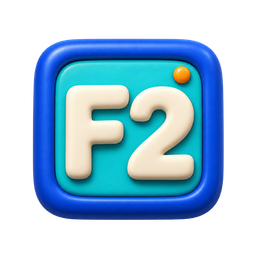

# 📘 Código de Bolso

### Programação e análise de dados para consultar e aprender no celular.

**📱 Android · 📴 Offline · 🔎 Busca local · 🎓 Fases de estudo**

**477 fichas · 35 categorias · 966 exemplos · Versão 0.8.1**

---

## 💡 Uma necessidade real de estudo

O Código de Bolso nasceu durante meus estudos de programação e análise de dados. Eu precisava voltar às apostilas para lembrar um comando, conferir uma sintaxe ou entender uma função. Queria encontrar essas explicações no celular, mesmo sem internet.

A proposta é reunir **o conceito, os dados, o código e a interpretação do resultado** em pequenas fichas. O conteúdo e a interface evoluem a partir do uso: explicações difíceis, repetições e controles desnecessários orientam as próximas correções.

## 🎨 Imagens que fazem parte do app

  
  
  

Amostras das fichas **SELECT**, **WHERE** e **SUBSTRING**, com legendas no aplicativo. São recursos reais do acervo, produzidos com assistência de IA e empacotados para funcionar offline.

A coleção tem **466 fichas com ilustrações 3D** e **11 fichas com gráficos nos exemplos**. Os gráficos somam 22 imagens; cinco indicadores visuais identificam as fases de estudo.

## 📖 Aprender pela leitura

Na versão 0.8.1, as **52 fichas com exemplos SQL** apresentam **87 exemplos** organizados assim:

1. **A pergunta:** o que queremos descobrir?
2. **Os dados:** tabelas pequenas com os registros usados, quando o exemplo consulta tabelas.
3. **O código:** a consulta ou operação relacionada à pergunta.
4. **O resultado:** a resposta com os nomes das colunas, quando tabular.
5. **A interpretação:** por que aquelas linhas e valores aparecem?

Por exemplo: ao procurar vendas acima de 300, a ficha apresenta valores de **800, 250 e 400**, mostra a consulta e explica por que somente as vendas de 800 e 400 permanecem.

O leitor acompanha o exemplo na própria ficha. Os códigos permanecem visíveis; **os botões de copiar, exportar e compartilhar foram retirados**. O aplicativo é um material de consulta e não executa os comandos.

## ✨ Recursos de consulta

| Recurso | Utilidade |
|---|---|
| 🔎 Busca local | Encontrar comandos, explicações e exemplos, com sinônimos e tolerância a erros de digitação |
| 🗂️ Áreas e categorias | Explorar um assunto por vez |
| ⭐ Favoritos e recentes | Retomar os conteúdos mais úteis |
| 📚 Glossário | Consultar termos e abrir as fichas relacionadas |
| 🧩 Exemplos e resultados | Entender a aplicação e conferir o raciocínio |
| 🎨 Personalização | Ajustar tema, cor e tamanho do texto |
| ↕️ Ordem pessoal | Organizar a lista conforme a rotina de estudo |
| 📴 Conteúdo local | Consultar textos e imagens sem conexão |

A busca pesquisa o acervo do aplicativo; não gera respostas novas com IA.

## 🧠 Assuntos presentes

| Área | Conteúdo |
|---|---|
| 🐍 Python | Tipos, textos, funções, erros, arquivos, classes e objetos |
| 📦 Coleções | Listas, tuplas, dicionários, sets e frozenset |
| 🧹 Tratamento de dados | Limpeza, expressões regulares e roteiros de transformação |
| 📊 Análise com Python | Pandas, NumPy, Matplotlib e Seaborn |
| 🌐 Coleta de informações | Web scraping e BeautifulSoup |
| 🗄️ Bancos de dados | SQL/PostgreSQL, modelagem, MySQL, NoSQL e MongoDB; exemplos específicos de SQL Server e Oracle identificados por banco |
| 📗 Excel | Fórmulas, buscas, condições, textos, datas, estatística e Power tools |
| 📈 Business Intelligence | Power BI, DAX, Power Query/M e Tableau |
| 🛠️ Ferramentas | Git, GitHub e VS Code |
| 🧭 Fundamentos | Granularidade, métricas, qualidade, amostragem e estatística descritiva |

## 🎓 Fases Fn

Cada ficha indica a fase do assunto principal na taxonomia de estudo. Os indicadores abaixo são os mesmos usados no app.

| Indicador | Fase | Referência de estudo | Fichas |
|---|---|---|---:|
|  | F1 | Fundamentos | 32 |
|  | F2 | Analista de Dados | 253 |
|  | F3 | Analista avançado | 179 |
|  | F4 | Cientista de Dados | 12 |
|  | F5 | Especialização | 1 |

A fase orienta a consulta e a sequência de estudo; não representa uma certificação de domínio.

## ⚙️ Como foi construído

| Tecnologia | Responsabilidade |
|---|---|
| Java + Android WebView | Carregar a interface local e integrar o app ao Android |
| HTML + CSS | Estruturar as telas e apresentar o conteúdo |
| JavaScript | Busca, navegação e preferências |
| JSON + localStorage | Organizar as fichas e guardar favoritos e posições de leitura |
| Python + JDK 17 + Android SDK 35 | Preparar conteúdo, verificar exemplos e compilar o APK |

O conteúdo e as imagens acompanham o APK. O manifesto não solicita permissão de internet. A compilação usa ferramentas próprias, sem Gradle. Os motores usados para conferir os exemplos são ferramentas de desenvolvimento e não fazem parte do aplicativo.

## ✅ Estado e verificações

**Entrega documentada: 0.8.1, de 22/10/2026. Portfólio atualizado em 27/10/2026.** Android mínimo: **8.0**.

| Verificação registrada na 0.8.1 | Resultado |
|---|---|
| PostgreSQL via PGlite/WASM | 80 exemplos executados, incluindo dois planos de execução |
| Interface | 1.608 verificações, abrangendo as 477 fichas |
| Tabelas apresentadas | 53 verificações adicionais, incluindo as 52 fichas SQL |
| Recursos offline | 493 recursos visuais decodificados, sem requisições externas |
| Atualização | Simulação a partir da 0.8.0 preservando favoritos e preferências |
| APK | Compilado com a assinatura original; assinatura v2/v3 e conteúdo empacotado conferidos |

Os registros não significam que todos os 966 exemplos foram executados. Os sete exemplos SQL Server/Oracle têm revisão documental, sem execução nesses servidores; os demais módulos não foram reexecutados integralmente nesta rodada. A instalação física da 0.8.1 ainda precisa de conferência no aparelho.

Veja [escopo e validação](docs/escopo_e_validacao.md) e [leitura no celular na versão 0.8.1](docs/leitura_0_8_1.md).

## 🤝 Concepção e desenvolvimento

**David dos Santos Boneli** — idealização, requisitos, escolhas de interface, prioridades e avaliação do uso cotidiano.

O desenvolvimento contou com assistência de inteligência artificial na implementação, nas imagens, nas revisões e na documentação. O projeto registra a transformação de uma necessidade de estudo em um aplicativo, com decisões revistas a partir da experiência de uso.

## 📚 Documentação

| Documento | Conteúdo |
|---|---|
| [Arquitetura](docs/arquitetura.md) | Funcionamento e organização técnica |
| [Escopo e validação](docs/escopo_e_validacao.md) | Evidências e limites dos testes |
| [Leitura no celular — 0.8.1](docs/leitura_0_8_1.md) | Mudanças de conteúdo e apresentação |
| [Revisão didática — 0.7.9](docs/revisao_0_7_9.md) | Registro da revisão anterior |
| [Padrão de atualizações](docs/padrao_atualizacoes.md) | Critérios para as próximas entregas |
| [Publicação](docs/publicacao.md) | Escopo público e origem das imagens |
| [Histórico](CHANGELOG.md) | Evolução documentada |
| [Direitos](DIREITOS.md) | Condições de disponibilização |

## 🔐 Sobre este repositório

Este repositório apresenta o portfólio do projeto, sua documentação e as amostras visuais selecionadas para o README. O código completo e o instalador permanecem reservados. Consulte [DIREITOS.md](DIREITOS.md) para as condições de disponibilização.
